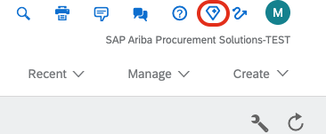
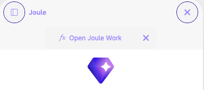
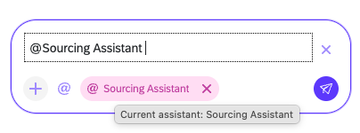

# Exercise 0 – Getting Started

In this exercise you open Joule in SAP Ariba and start a conversation with the Sourcing Assistant. You repeat these steps at the start of every exercise.

## Before you start

At your seat you receive a **personal handout** with:

- Your **username** and **password**
- The links to **Joule** and the **SAP Ariba** lab system
- Your **event ID** for Exercise 3

You can also [download the participant handout](AS264_Participant_Handout.docx) (find your page by username). Your password is given by the moderators at the start of the session.

Keep the handout with you. Every participant has their own user and event, so use only the details on your handout.

### Lab data

The lab system is preconfigured with the following, which the agents use in Exercises 1 and 2:

| Sourcing template | Used for |
|---|---|
| Template RFP IT Hardwares | IT equipment events (Exercise 1) |
| Template RFP Landscaping Services | Landscaping events (Exercise 2) |
| Template RFP Catering | Catering events (optional) |

Suppliers are set up in three categories: **IT (43)**, **Food & Beverage (50)**, and **Building, Construction and Maintenance Services (72)**.

## Log in

### 1. Sign in to SAP Ariba

Open the **SAP Ariba** link from your handout and sign in with your username and password.

### 2. Open Joule

Click the **Joule** icon in the top right corner of the SAP Ariba screen.

### 3. Open Joule Work (optional)

For a full-screen experience, click **Open Joule Work**. This is not required.

### 4. Select the Sourcing Assistant

In the message box, type `@` and choose **Sourcing Assistant**. Each exercise tells you what to type next.

## Need help?

If you get stuck, raise your hand and a moderator will help you.

## Summary

You can now open Joule and address the Sourcing Assistant. Each exercise starts with a **fresh Joule session** (close Joule and reopen it, or start a new conversation) so that context from earlier exercises does not carry over.

---

[Overview](../../README.md) | [Exercise 1 ▶](../ex1/README.md)
