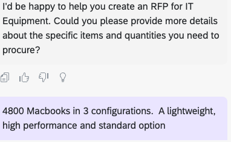
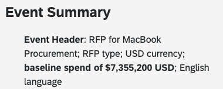
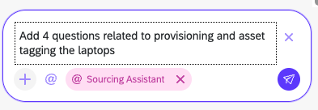
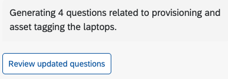
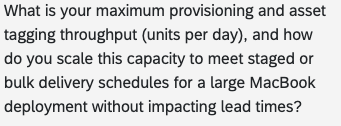
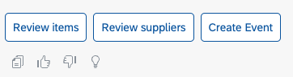
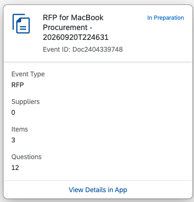
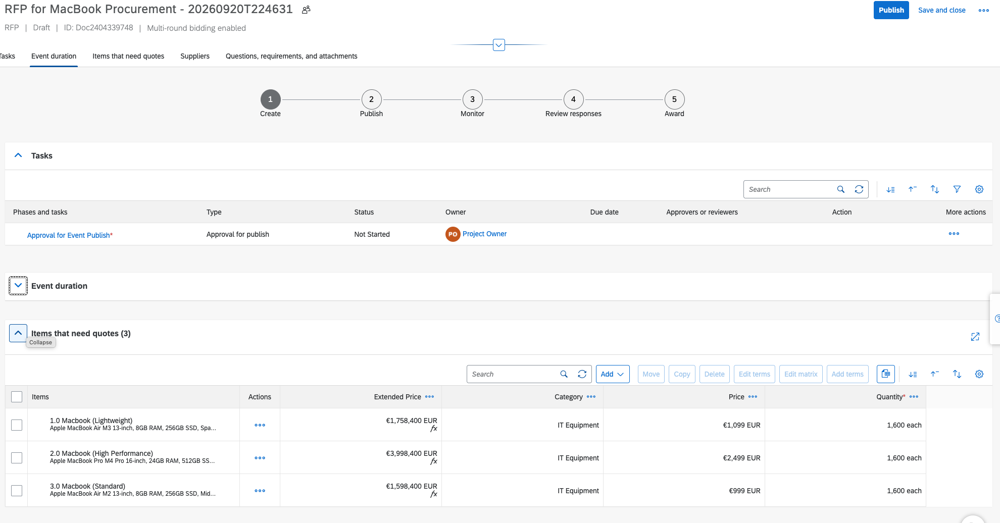

# Exercise 1 – Create a Sourcing Event from a Prompt

In this exercise you use the **Sourcing Event Agent** to create an RFP for IT equipment from a short description, add evaluation questions, and create the event in SAP Ariba.

> **Start a fresh Joule session** for this exercise (see [Exercise 0](../ex0/README.md)).

### 1. Start the request

Open Joule and select **@Sourcing Assistant**, as in Exercise 0. Then type:

```
Create a sourcing event for IT equipment
```

### 2. Provide details

When Joule asks for more information, type:

```
4800 Macbooks in 3 configurations. A lightweight, high performance and standard option
```



### 3. Review the summary

Review the event summary. It should include the total value, line items, template, and number of questions.



### 4. Review the questions

Choose **Review questions**.


### 5. Add questions

Ask Joule to add questions, for example:

```
Add 4 questions related to provisioning and asset tagging the laptops
```



### 6. Review the updated questions

Choose **Review updated questions**.



### 7. Check the new questions

Confirm that the agent added the 4 new questions.



### 8. Create the event

Choose **Create Event**.



### 9. Open the event

On the event card, choose **View Details in App**.



### 10. View the RFP

Review the created RFP in SAP Ariba Guided Sourcing.



## Summary

You created a complete RFP, with line items and evaluation questions, from a two-line conversation with the Sourcing Event Agent.

---

[◀ Exercise 0](../ex0/README.md) | [Overview](../../README.md) | [Exercise 2 ▶](../ex2/README.md)
