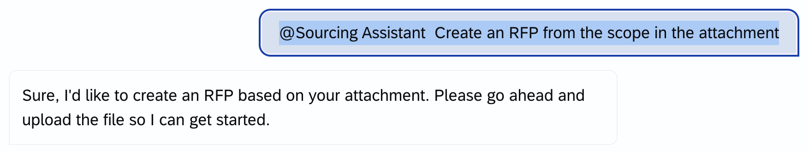
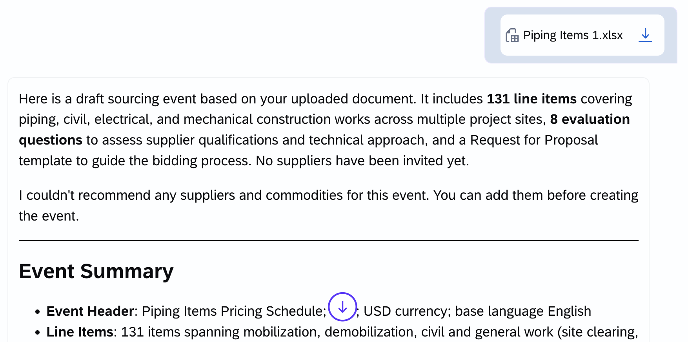

# Exercise 2 – Create a Sourcing Event from an Attachment

In this exercise you create an RFP by uploading an existing scope document. The Sourcing Event Agent extracts the line items and requirements from the file, then use Joule to suggest and add supplier questions.

> **Start a fresh Joule session** for this exercise (see [Exercise 0](../ex0/README.md)).

## Before you start: choose and download a sample file

Pick one of the scope documents in the [sample-files](sample-files/) folder:

| File | Scenario |
|---|---|
| [Sample_RFP_Corporate_Catering.docx](sample-files/Sample_RFP_Corporate_Catering.docx) | Corporate catering and food services, 8 line items |
| [Sample_RFP_MRO_Spare_Parts.docx](sample-files/Sample_RFP_MRO_Spare_Parts.docx) | MRO spare parts for a manufacturing plant, 10 line items, detailed terms |
| [Sample_Bid_Sheet_Piping_Construction.xlsx](sample-files/Sample_Bid_Sheet_Piping_Construction.xlsx) | Pipeline and meter station construction, 130+ line items (Excel) |

To download a file, click it, then click the **Download raw file** button (the download icon, top right).

> **Note:** Some screenshots below come from other example files. Your event name, line items and questions will match the file you chose.

### 1. Ask for an RFP from an attachment

Open Joule and select **@Sourcing Assistant**. Then type:

```
Create an RFP from the scope in the attachment
```

### 2. Wait for the Sourcing Event Agent

The Sourcing Assistant hands your request over to the **Sourcing Event Agent**, which asks you to upload the file. Wait for this reply before you upload anything.



### 3. Upload the file

Click the **+** (attachment) icon in the message box and select the sample file you downloaded, or drag and drop it into Joule.

### 4. Review the summary

The agent reads the document and returns a draft event. Check how much it extracted: event name, total value, line items, template, and number of questions.



### 5. Review the questions

Choose **Review questions**. Note the proposed number of questions.


### 6. Ask for suggestions

Ask Joule:

```
Are there any other questions I should be asking new suppliers?
```


### 7. Add questions on a topic

Ask Joule to add questions on a topic of your choice, for example:

```
Please add questions about Service Level Agreements (SLAs) and Responsibilities
```


### 8. Review the updated questions

Choose **Review updated questions**. Note how many new questions were added.


### 9. Create the event

Choose **Create Event**.


### 10. Open the event

On the event card, choose **View Details in App**. Check that all the questions are there.


### 11. View the RFP

Review the created RFP in SAP Ariba Guided Sourcing.

## Optional: try another file

Start a new conversation and repeat the exercise with a different sample file. Compare what the agent extracts from a Word RFP and from an Excel price sheet.

## Summary

You turned an existing scope document into a structured RFP and used Joule to strengthen the supplier questionnaire.

---

[◀ Exercise 1](../ex1/README.md) | [Overview](../../README.md) | [Exercise 3 ▶](../ex3/README.md)
