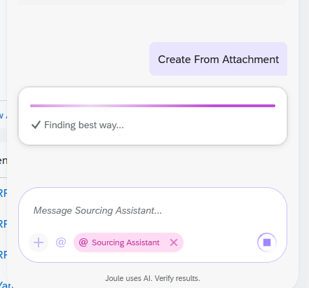
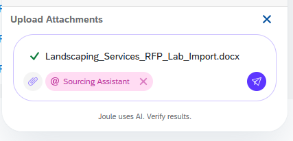
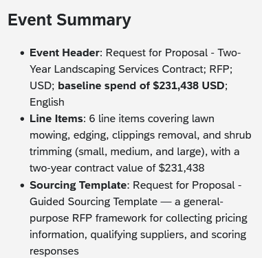
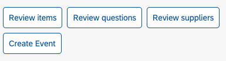
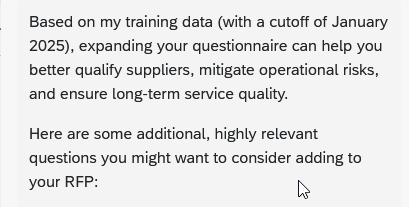
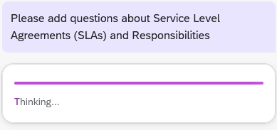
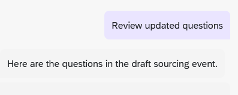

# Exercise 2 – Create a Sourcing Event from an Attachment

In this exercise you create an RFP for landscaping services by uploading an existing requirements document, then use Joule to suggest and add supplier questions.

> **Start a fresh Joule session** for this exercise (see [Exercise 0](../ex0/README.md)).

### 1. Start the request

Open Joule and select **@Sourcing Assistant**. Then type:

```
Create an RFP for yard maintenance and landscaping services.
```

### 2. Choose to create from an attachment

Choose **Create from Attachment**.



### 3. Upload the file

Select the file `Landscaping_Services_RFP_Lab_Import.docx`, or drag and drop it into Joule.



### 4. Review the summary

Review the event summary. It should include the total value, line items, template, and number of questions.



### 5. Review the questions

Choose **Review questions**. Note the proposed number of questions.



### 6. Ask for suggestions

Ask Joule:

```
Are there any other questions I should be asking new suppliers?
```



### 7. Add questions on a topic

Ask Joule to add questions on a topic of your choice, for example:

```
Please add questions about Service Level Agreements (SLAs) and Responsibilities
```



### 8. Review the updated questions

Choose **Review updated questions**. Note how many new questions were added.



### 9. Create the event

Choose **Create Event**.


### 10. Open the event

On the event card, choose **View Details in App**. Check that all the questions are there.


### 11. View the RFP

Review the created RFP in SAP Ariba Guided Sourcing.

## Summary

You turned an existing requirements document into a structured RFP and used Joule to strengthen the supplier questionnaire.

---

[◀ Exercise 1](../ex1/README.md) | [Overview](../../README.md) | [Exercise 3 ▶](../ex3/README.md)
