# Exercise 3 – Analyze Bids and Negotiate

In this exercise you use the **Bid Analysis & Negotiation Agent** on a published event that already has supplier bids. You review the analysis, change the procurement objective, build a negotiation strategy, draft supplier emails, and create a new bidding round in SAP Ariba.

> **Start a fresh Joule session** for this exercise (see [Exercise 0](../ex0/README.md)).
>
> **Your event:** use the event ID on your handout (for example `Doc1234567890`). Your event may be an IT hardware, MacBook, or landscaping RFP, so your results will differ from the screenshots, but the steps are the same.

### 1. Start the analysis

Open Joule and select **@Sourcing Assistant**. Then type, using the event ID from your handout:

```
Analyze bids for <Doc ID>
```

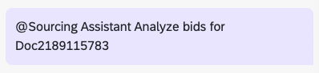

### 2. Review the analysis

Review the objective (the reason for the RFP), the recommendation, the rationale, and any outliers.

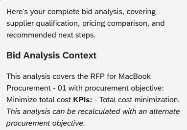

### 3. Change the objective

Ask Joule:

```
Change the objective to focus primarily on delivery and installation timelines
```

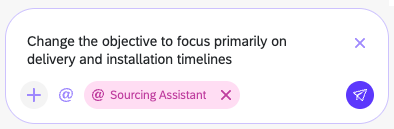

### 4. Create a negotiation strategy

Ask Joule:

```
Create a negotiation strategy
```

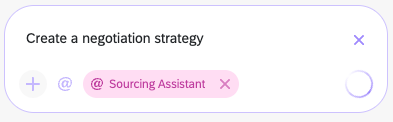

### 5. Review the strategy

Review the counteroffer price, the supplier down-select, and the next steps.

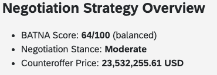

### 6. Draft negotiation emails

Choose **Draft negotiation emails**.

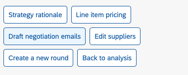

### 7. Review the emails

Review the drafts. Try asking Joule to make them more or less aggressive.

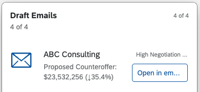

### 8. Create a new round

Choose **Create a new round**. This creates a new round of the event to capture the suppliers' new bids.

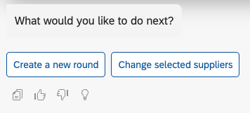

### 9. Confirm the new round

Once the event details are generated, choose **Confirm new round**.

> **Note:** The duration shown is the actual duration of the last round.

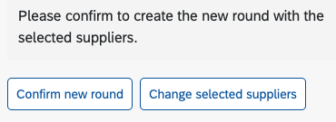

### 10. Go to the event

Choose **Go to event**.

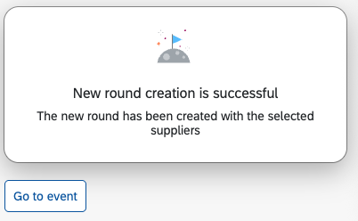

### 11. Open the event in SAP Ariba

Choose **Open event in Ariba**.

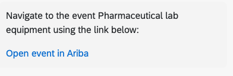

### 12. Monitor the event

Review the event's **Monitor** page.

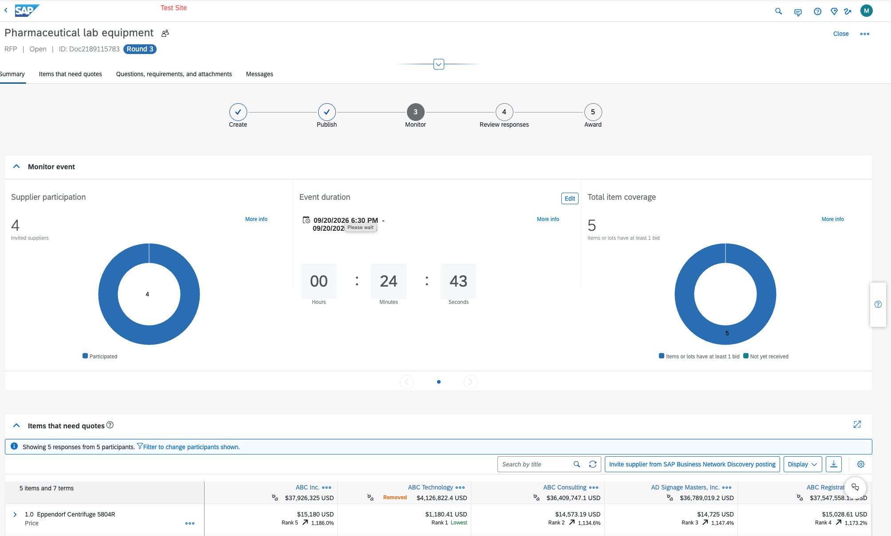

## Summary

You went from submitted bids to a new negotiation round, covering analysis, objective change, strategy, and supplier emails, without leaving the Joule conversation.

---

[◀ Exercise 2](../ex2/README.md) | [Overview](../../README.md)
